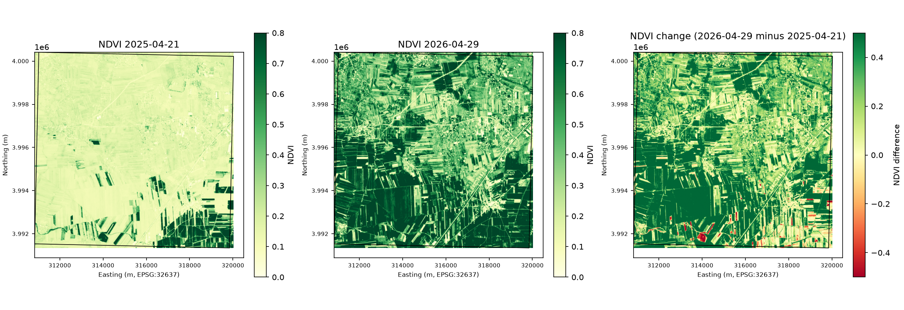
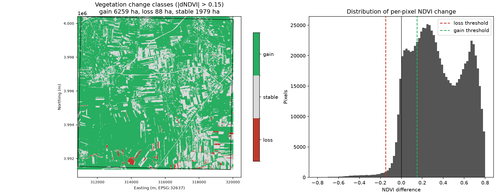

# Sentinel-2 NDVI change detection

Year-on-year vegetation change over farmland south-west of Aleppo, Syria,
computed from Sentinel-2 L2A imagery with Python. The pipeline finds the
clearest scene in each of two date windows, reads only the pixels it needs
straight from cloud-optimised GeoTIFFs on AWS, masks clouds with the Scene
Classification Layer, computes NDVI, and reports where vegetation gained or
lost between the two dates.

I built this to learn the Sentinel-2 workflow end to end (STAC search,
windowed COG reads, radiometric scaling, cloud masking, change statistics)
on an area I know. Everything runs from a laptop with no account or API key.





## Result

Two cloud-free spring acquisitions on tile 37SCA, both 100 percent valid
over the area of interest:

| | Scene | Date | Cloud cover |
|---|---|---|---|
| Before | S2A_37SCA_20250421_1_L2A | 2025-04-21 | 0.2 % |
| After | S2B_37SCA_20260429_0_L2A | 2026-04-29 | 0.8 % |

| Metric | Value |
|---|---|
| Area analysed | 8 326 ha (906 x 919 pixels at 10 m) |
| Mean NDVI, April 2025 | 0.21 |
| Mean NDVI, April 2026 | 0.56 |
| Vegetation gain (dNDVI > 0.15) | 6 259 ha, 75 % of area |
| Stable | 1 979 ha, 24 % |
| Vegetation loss (dNDVI < -0.15) | 88 ha, 1 % |

Spring 2026 is far greener than spring 2025 across almost the whole block.
The per-pixel histogram is bimodal: one group of fields gained about 0.2
NDVI and another gained about 0.65, which is the difference between
marginal recovery and a full crop canopy. This is consistent with the
widely reported 2025 drought in Syria, but the comparison is two single
dates eight calendar days apart, so part of the signal is phenology rather
than year-to-year difference. A proper monitoring product would use a
monthly composite rather than one scene per year.

Full numbers are in `outputs/summary.json`.

## Method

1. **Search.** Query the public [Earth Search](https://earth-search.aws.element84.com/v1)
   STAC catalogue (`sentinel-2-l2a`) for scenes under 10 % cloud whose
   footprint fully contains the AOI, sorted by cloud cover.
2. **Read.** For each candidate, open the red (B04), NIR (B08) and SCL
   assets with `rasterio` and read only the window covering the AOI.
   The 20 m SCL band is resampled onto the 10 m grid. A 9 km block is
   three HTTP range reads of a few megabytes each, no full-tile download.
3. **Mask.** Drop pixels classified as cloud (medium, high, cirrus), cloud
   shadow, snow, saturated or no-data. If less than 90 % of the AOI
   survives, move to the next candidate scene.
4. **Scale.** Convert digital numbers to surface reflectance using the
   scale and offset from the STAC raster extension, with one correction
   described below.
5. **NDVI and change.** NDVI = (NIR - red) / (NIR + red) per scene, then
   after minus before. Pixels with |dNDVI| above 0.15 are classed as gain
   or loss; areas are reported in hectares.
6. **Outputs.** Three GeoTIFFs (NDVI before, after, difference, all
   EPSG:32637 with NaN no-data), two figures, and a JSON summary.

### The offset pitfall

ESA L2A products since processing baseline 04.00 store
`DN = (reflectance + 0.1) * 10000`, and the STAC metadata on Earth Search
faithfully advertises `scale 0.0001, offset -0.1`. But Earth Search already
subtracts that offset when it builds its COGs and flags this with the item
property `earthsearch:boa_offset_applied: true`. Applying the offset a
second time pushed dark red pixels below zero and inflated the 2026 mean
NDVI to 0.81. The code now checks the flag and ignores the metadata offset
when it is set. The unit test `test_band_scaling_respects_offset_applied_flag`
pins this behaviour.

## Run it

```bash
python -m venv .venv
.venv/Scripts/activate        # Windows; use source .venv/bin/activate elsewhere
pip install -r requirements.txt

python run_pipeline.py                                  # defaults: Aleppo AOI, Apr 2025 vs Apr 2026
python run_pipeline.py --before 2024-03-20/2024-04-30 --after 2025-03-20/2025-04-30
python run_pipeline.py --aoi path/to/your_area.geojson --threshold 0.2 --out outputs_mine

python -m pytest tests
```

Any WGS84 polygon works as `--aoi`. Keep it to a few hundred square
kilometres so the window read stays fast and both scenes land on the same
Sentinel-2 tile; the script stops with a clear message if the two scenes
do not share a grid.

## Layout

```
run_pipeline.py          CLI: search, read, mask, compare, plot, summarise
src/s2ndvi/stac.py       Earth Search query, coverage check, band scaling
src/s2ndvi/raster.py     windowed COG reads, SCL cloud mask, NDVI
src/s2ndvi/change.py     difference raster and area statistics
src/s2ndvi/plots.py      figures
aoi/aleppo_fields.geojson  default area of interest
tests/test_ndvi.py       unit tests for the maths and the scaling rule
outputs/                 figures and summary.json (GeoTIFFs are ignored by git)
```

Stack: Python 3.14, rasterio, pystac-client, GeoPandas, Shapely, pyproj,
NumPy, Matplotlib.

## Limitations and next steps

- Single-date comparison. Monthly median composites would remove the
  phenology and residual-cloud noise.
- NDVI saturates over dense canopies. For crop condition a red-edge index
  such as NDRE, or a soil-adjusted index, would separate the high end better.
- No field boundaries. Zonal statistics over a parcel layer would turn the
  pixel map into a per-field table that an agronomist could act on.
- No reprojection. Scenes from different UTM zones or tiles are rejected
  rather than aligned.

## Data

Sentinel-2 L2A imagery from the European Union Copernicus programme,
served as cloud-optimised GeoTIFFs by Element 84's Earth Search on AWS.

MIT licence.
